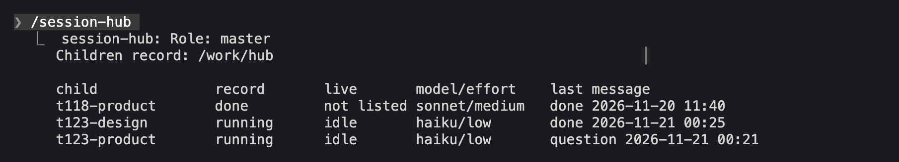
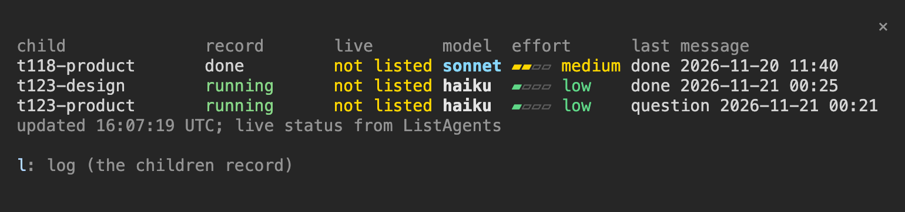
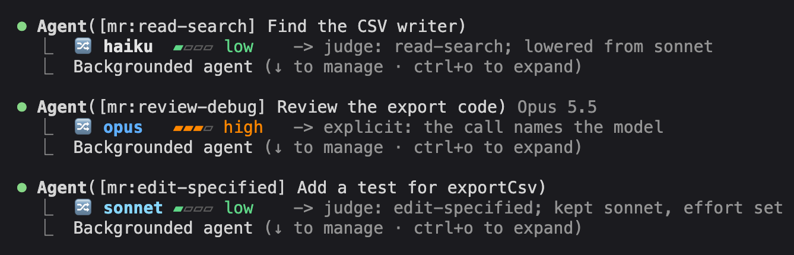
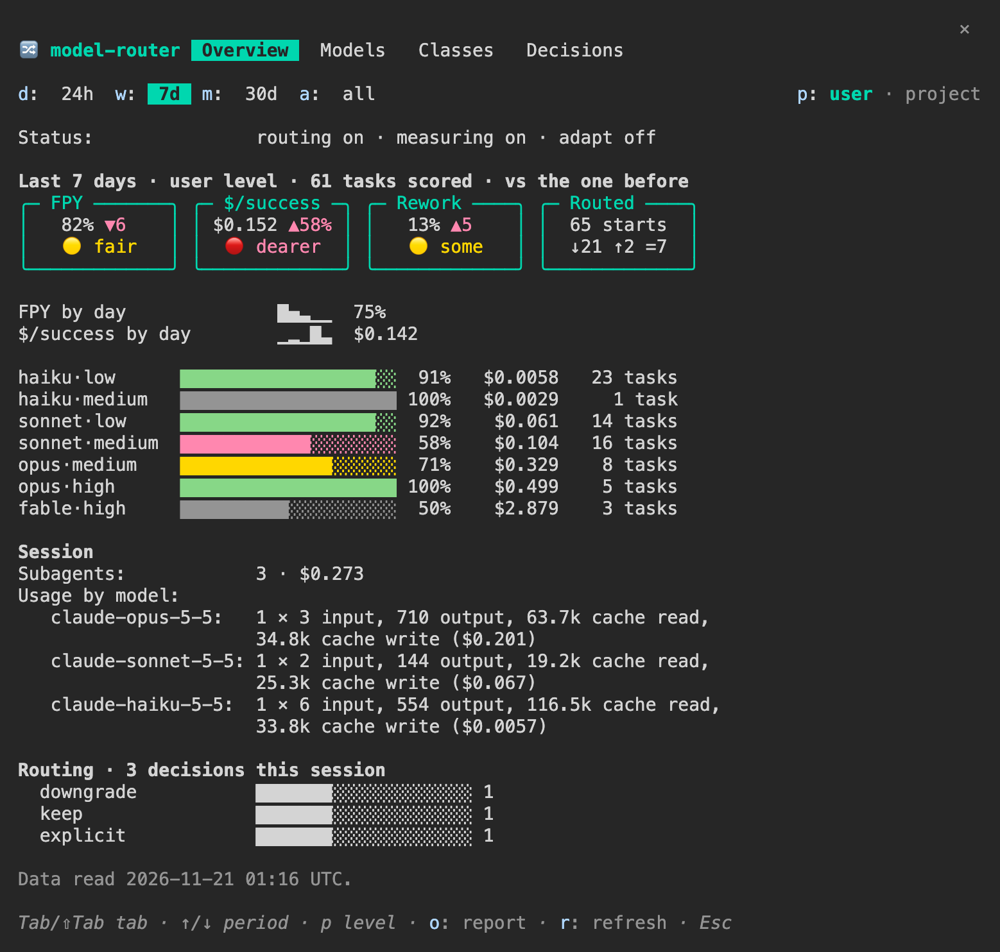
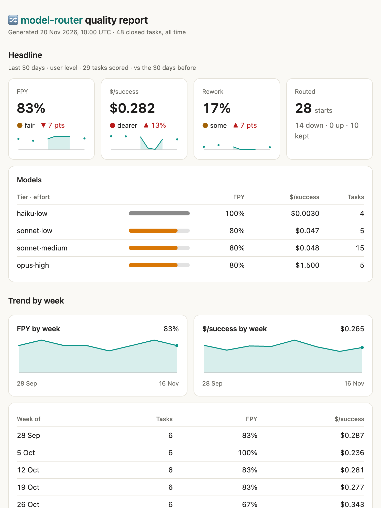

# agent-orchestration

**Run many Claude Code sessions across many repositories, and run each piece of work on the right model.**

Two plugins for teams that have outgrown one session in one repository:

- **[`session-hub`](session-hub/)**: one master session coordinates child sessions, one per repository, each
  limited to its own scope.
- **[`model-router`](model-router/)**: every subagent gets the model and effort its task needs, and you can see
  on your own machine whether those choices worked.

Each plugin works on its own and does more alongside the other.

📘 **[Read the user manual (PDF)](docs/manual/user-manual.pdf)**: every feature, with examples and screenshots.

---

## session-hub: one master, many repositories, clear limits

Your product spans a backend, a frontend, a design system and the docs. A single agent working across all of them
skips each repository's own instructions, skills and agents. Several agents working side by side step on each
other's files.

`session-hub` turns a folder of repositories into a **hub**. A master session starts one child session per
repository, and each child works inside that repository with its rules loaded. Every child knows its task, what
it may change, which model it uses, and that it reports only to the master.



**What you get**

- **Children with a real scope.** A hook blocks file edits outside the child's write root (its repository or
  worktree), resolving links and `..` first. When the guard cannot decide, it blocks and says why: it fails
  closed.
- **Requests go up, not sideways.** A child that needs a change elsewhere sends an `out-of-scope` message to the
  master instead of editing another repository.
- **A record and a panel.** The master keeps a record of every child, stored outside the hub, and a live panel
  shows each child's state, model and last message.
- **Shell commands are checked too.** With mods on, a best-effort check also blocks redirections and common
  file-writing commands that target a path outside the write root, through `cd` and wrappers.
- **Messages are not orders.** Messages from other sessions, the master's included, are marked as information,
  not authorization, so a child acts on them only within its scope.
- **Works where you work:** Herdr, tmux, `claude --bg`, plain commands to paste, or the desktop app (where the
  scope rests on the handoff alone).



## model-router: the right model for each task, and a measure of how well it worked

Left to itself, an agent runs every subagent on its own model. Simple searches run on the most expensive model,
while hard reviews sometimes run on a cheap one and come back for rework.

`model-router` gives the agent **one short grid** for choosing a model and an effort for each task. The agent
passes both on every subagent start, and you see each choice the moment it is made:



When a built-in subagent start (general-purpose or Explore) still carries no model, a fast judge model
classifies the task and sets one. Explicit choices,
forks and agents with a fixed model are left alone. Any error leaves the request unchanged: the router fails open.

**Then it measures.** For each kind of task and each model and effort, `model-router` tracks:

- **First-pass yield**: how often the work was right the first time;
- **rework**: how often it had to be redone;
- **cost per success**: what a task that worked actually cost.

`/model-router` opens a usage view modelled on Claude Code's own `/usage`, with Overview, Models, Classes and
Decisions tabs, a choice of period, and user or project level:



One key writes a self-contained quality report with the trend week by week:



**Your measurements stay on your machine**, under your Claude Code config folder, and nothing is written inside
your repositories. The judge's one call goes through your session's own client, like any subagent. A
project can record its own exceptions, such as "always use opus for migrations", in its `AGENTS.md`.

*Coming in 0.4: the router uses its own quality data to adjust its choices.*

> The screenshots come from the manual and show demonstration data.

---

## Install

Both plugins are listed in the `mrbogomips` marketplace:

```text
/plugin marketplace add MrBogomips/claude-plugins
/plugin install session-hub@mrbogomips
/plugin install model-router@mrbogomips
```

Requirements: `node` on `PATH`, and for `session-hub` Claude Code 2.1.224 or later (cross-session messages).

The skills and the classic hooks work with mods turned off. The mods need Claude Code 2.1.329 or later with mods
turned on: in `session-hub` the send guard, the shell check, message marking and the children panel; in
`model-router` routing, measurement, the per-Agent lines and the usage view.

## Documentation

| Document | For |
|---|---|
| [User manual (PDF)](docs/manual/user-manual.pdf) | Using both plugins: features, commands, examples, screenshots. Source: `docs/manual/manual.html`, built with `docs/manual/build.sh`. |
| [`session-hub` README](session-hub/README.md), [`model-router` README](model-router/README.md) | Each plugin's components, commands and options. |
| [Architecture](docs/architecture.md) | How both plugins work, as built, and what is planned. |
| [Design](docs/design/) | The design of both plugins and the tests run before building them. |
| [Research](docs/research/) | The research behind the design. |

## License

MIT, see [LICENSE](LICENSE).
