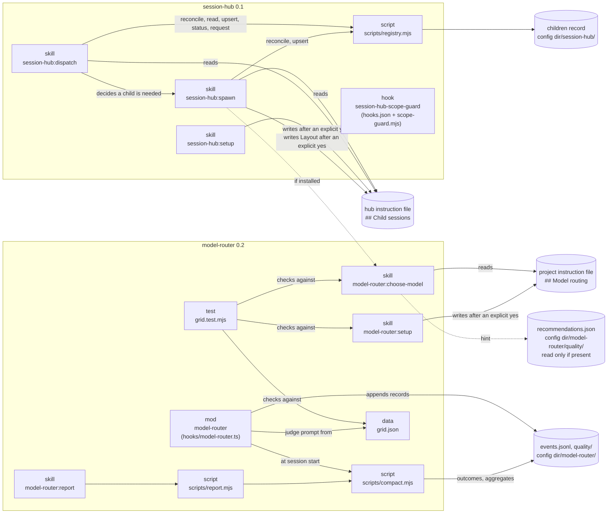
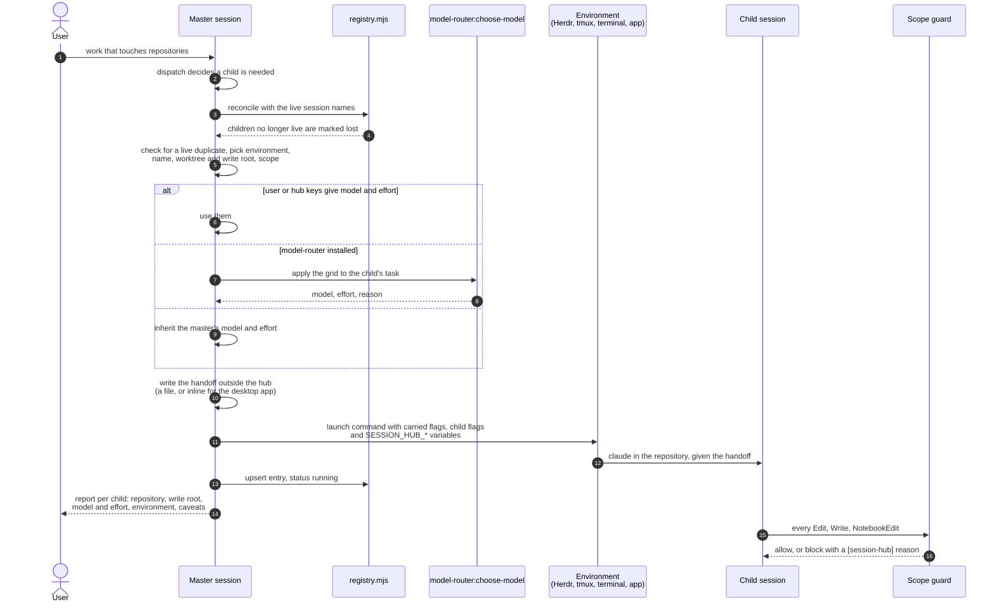
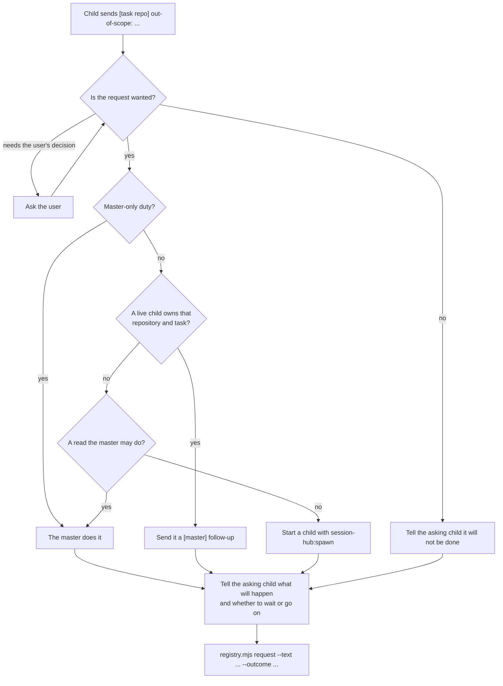
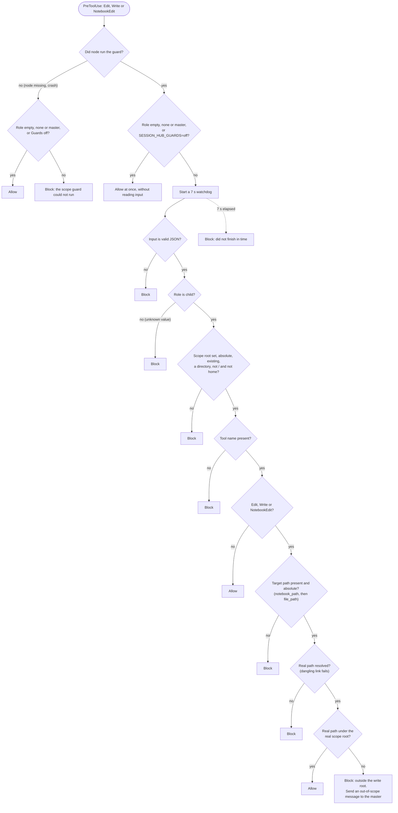
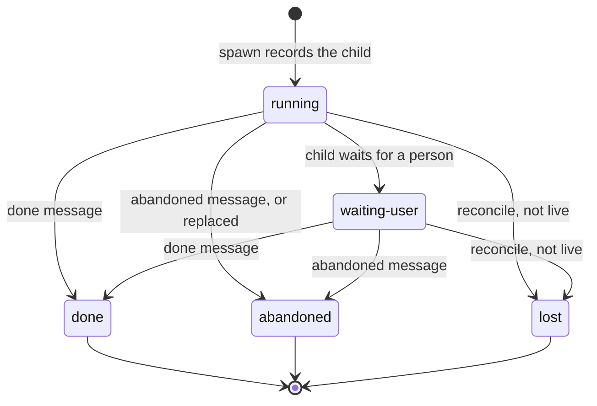
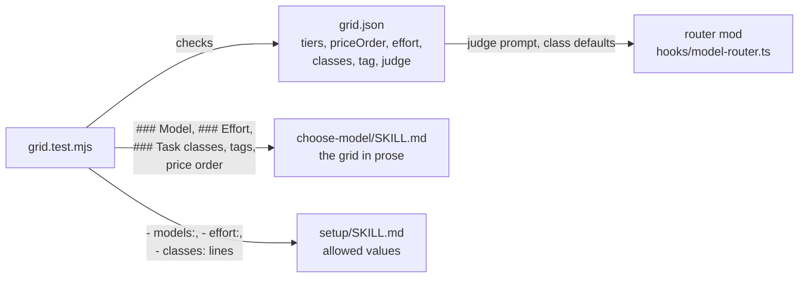

# Architecture

This document describes the two plugins in this repository as built (`session-hub` 0.1, `model-router` 0.2):
what each one is for, what it is made of, how its parts work together, what it keeps on disk and how it behaves when something fails. Parts
that are planned for later releases are marked **Planned** with their release; they may change before they ship.

| Plugin | Version | In one line |
|---|---|---|
| `session-hub` | 0.1.0 | A master session in a hub of repositories starts one child session per repository, gives each a scope, routes their requests and keeps a record of them. |
| `model-router` | 0.2.0 | One written grid that decides the model and the effort level of every subagent, child session or workflow agent; a mod that routes subagent starts carrying no model and measures locally how well each choice worked. |

## Contents

- [Terms](#terms)
- [The two plugins and their independence](#the-two-plugins-and-their-independence)
- [Components](#components)
- [Roles](#roles)
- [Main flows](#main-flows)
- [The scope guard](#the-scope-guard)
- [The children record](#the-children-record)
- [The model-router grid](#the-model-router-grid)
- [State on disk](#state-on-disk)
- [Failure policy](#failure-policy)
- [Compatibility](#compatibility)
- [Planned releases](#planned-releases)
- [For contributors](#for-contributors)

## Terms

| Term | Meaning |
|---|---|
| Hub | A folder that holds several git repositories, each with its own instructions, skills and agents. |
| Master | The session opened in the hub. It coordinates and never writes in a child repository. |
| Child | A Claude Code session started by the master with a repository (or a worktree of it) as working directory, so it loads that repository's own rules. |
| Write root | The one folder where a child may create and change files. |
| Handoff | What the master writes for each child: role, goal, scope, references, siblings, message rules, first step. A file in every environment except the desktop app, where it is passed inline to the start tool. |
| Children record | A JSON file, kept by the master outside the hub, with one entry per child. |
| Grid | The rules `model-router` uses to choose a model tier and an effort level. |
| Task class | One of six fixed labels for the kind of work a subagent does, such as `read-search` or `review-debug`. |

## The two plugins and their independence

The plugins solve two separate problems and are installed separately.

- `session-hub` coordinates sessions across the repositories of a hub. Work inside a repository needs a session
  started in that repository: subagents, `--add-dir` and similar options run from the master's folder and miss
  the repository's own instructions.
- `model-router` chooses the model and the effort for any agent an agent starts. It works in any project, with or
  without a hub.

Each plugin works without the other. Where they meet, a skill names the other plugin's skill in full
(`<plugin>:<skill>`) and checks at run time whether it is installed:

- With `model-router` installed, `session-hub:spawn` loads `model-router:choose-model` to choose a child's model
  and effort when neither the user nor the hub configuration did.
- Without it, a child inherits the master's model and effort, and `spawn` says so in its report.

`session-hub` holds no copy of the grid. `model-router` knows nothing about hubs.

The hook, the messages, the variables and the state folders carry the plugin's name: the
`session-hub-scope-guard` hook, the `[session-hub]` prefix of the guard's and the record script's messages, the
`SESSION_HUB_*` variables, and the `session-hub/` and `model-router/` state folders. Two other markers are short
on purpose: `mr` in the router's task-class tag (`[mr:<class>]`), and the message prefixes between sessions,
`[master]` and `[<task> <repo>]`.

## Components



### session-hub

| Component | Kind | Role |
|---|---|---|
| `session-hub:dispatch` | skill | Master side. Decides, per repository a piece of work touches, whether the master reads it, a subagent reads it, or a child works in it. Handles the children's messages, routes out-of-scope requests, keeps duties reserved to the master. |
| `session-hub:spawn` | skill | Starts one child per repository in the detected environment, with a scope, a model, an effort level, the `SESSION_HUB_*` variables and a handoff file. Records each child. |
| `session-hub:setup` | skill | Writes or updates the `## Child sessions` section of the hub's instruction file (`AGENTS.md`, else `CLAUDE.md`), only after the user's explicit yes. |
| `session-hub-scope-guard` | hook | `PreToolUse` hook on `Edit`, `Write` and `NotebookEdit`, defined in `hooks/hooks.json` and implemented in `hooks/scope-guard.mjs`. In a child, blocks a write outside the write root. |
| `scripts/registry.mjs` | script | The only writer of the children record: reads, merges and writes it atomically under a lock. |

The `spawn` skill carries its reference material under `skills/spawn/references/`: the hub configuration keys
(`hub-config.md`), the handoff template (`child-prompt.md`), and how to start a child in each environment
(`environments.md` and one file per environment).

### model-router

| Component | Kind | Role |
|---|---|---|
| `model-router:choose-model` | skill | States the grid. Loads whenever an agent is about to start a subagent, a child session or a workflow of agents, and makes it pass a model and an effort explicitly. |
| `model-router:setup` | skill | Writes or updates a `## Model routing` section in the project's instruction file with the project's defaults and exceptions, only after the user's explicit yes. |
| `model-router:report` | skill | Runs `scripts/report.mjs` and gives the user the page's path. Computes nothing itself. |
| `model-router` | mod | `hooks/model-router.ts`, registered as a module in `hooks/hooks.json`. Routes subagent starts that carry no model and records the quality loop's events. Thin glue over the plain modules in `lib/`. |
| `/model-router` | command | Registered by the mod: routing state and the latest ten decisions; `on` or `off` for the session. |
| `lib/*.mjs` | modules | Plain ES modules with no Node or engine import, loaded by both the mod and the scripts: judge prompt and answer (`judge.mjs`), routing table and thresholds (`route.mjs`), tag and similarity (`text.mjs`), model families and effort levels (`tiers.mjs`), outcomes (`outcome.mjs`), aggregates (`aggregate.mjs`), project id (`project-id.mjs`), report page (`report-html.mjs`). Unit-tested with `node:test`. |
| `scripts/compact.mjs`, `scripts/report.mjs` | scripts | Node, no dependencies. Compaction closes outcomes and updates the aggregates under a lock; the report renders them into one self-contained page and opens it. |
| `grid.json` | data | The same grid in machine-readable form, with each class's usual choice (`default`); the judge's prompt is generated from it. |
| `grid.test.mjs` | test | Fails when `grid.json` and the two skills drift apart. |
| `tests/model-router.test.ts` | test | The mod's tests, run by `claude plugin test ./model-router`. |

The skills work with mods turned off; the router, the command and the measurement need the mod.

### The router mod

At a subagent start through the `Agent` tool, a `tool.call` hook decides the case and asks the judge, and sets the
effort on the call itself; the `agent.spawn` hook that follows (same `tool_use_id`) sets the model against the
parent's model and logs the decision. An explicit model, a fork, a resume, routing turned off, a session-wide
subagent model, and an agent whose definition fixes a model (or that the mod cannot read: a plugin's agent) are
kept. The judge is one call to the fast tier (8 s limit) with a prompt generated from `grid.json`; the task is
wrapped as data with closing tags escaped. A downgrade needs confidence 0.6, an upgrade 0.3; risk above 0.7 (or a
`!` in the class tag) forces the deep tier and at least `high` effort.

### The quality loop (measuring only in 0.2)

The mod appends `decision`, `spawn`, `signal` (`write`, `tool-error`, `prompt`, `stop`, `resume`), `report` and
`session-end` records to `events.jsonl` with `cat >>` through `$.process.run`. Compaction, started by the mod at
session start and by the report, decides the outcome of every task whose rework window closed (`success`,
`rework`, `failure`, `cancelled`), appends it as an `outcome` record, and folds the learned ones into cells of
class × tier × effort at two levels (user, project), with aging and the grid as prior. The report shows first-pass
yield, rework rate, cost per task and per successful task, the explored share, a recommendation per class, a
weekly trend and the router's decisions. The router does not use the data until 0.3.

## Roles

A session is a **master**, a **child**, or **neither**. The role is fixed at launch and never inferred from the
conversation.

| Role | How a session gets it | What the plugins do in it |
|---|---|---|
| Child | Its launch command sets `SESSION_HUB_ROLE=child`. `spawn` does this. | The scope guard checks every `Edit`, `Write` and `NotebookEdit`. The handoff gives the scope and the message rules. |
| Master | No variable is needed. A session in the hub that runs `dispatch` or `spawn` acts as master. `SESSION_HUB_ROLE=master` is accepted and treated by the guard like no variable. | The skills read the hub configuration, start children and keep the record. The guard does nothing. |
| Neither | No `SESSION_HUB_ROLE`, or the value `none` or `master`. | The guard exits at once without reading its input. |

`SESSION_HUB_ROLE` is read without regard to case or surrounding spaces. Any value other than empty, `none`,
`master` or `child` makes the guard block every write, so that a typo cannot switch the guard off, unless
`SESSION_HUB_GUARDS` is `off`, which turns the guard off whatever the role.

### Role variables

`spawn` sets these on the child's launch command. The names are fixed.

| Variable | Value |
|---|---|
| `SESSION_HUB_ROLE` | `child` |
| `SESSION_HUB_MASTER` | the master's session name |
| `SESSION_HUB_SCOPE_ROOT` | the write root, absolute; it must exist when the child starts |
| `SESSION_HUB_HANDOFF` | the handoff file, absolute |
| `SESSION_HUB_REGISTRY` | the children record, absolute; a child only reads it |
| `SESSION_HUB_GUARDS` | `on`, or `off` when the hub's *Guards* key says so; absent means `on` |

### Launch command

A child starts the way the master was started, so that it uses the same account and configuration folder (two
sessions with different configuration folders cannot message each other). `spawn` reads the master's own
arguments from the process list and builds the child's command from:

1. **Carried flags** that configure the session, such as `--settings`, `--mcp-config`, `--plugin-dir`,
   `--setting-sources`, `--agent`, `--append-system-prompt`. Flags that belong to the master's own session
   (`--name`, `--resume`, `--continue`, `--worktree`, `--add-dir`, a prompt and others) and permission flags are
   left out.
2. **Identity variables**: `CLAUDE_CONFIG_DIR` when set, and `HOME` when it differs from the account's home.
   Nothing else from the environment is copied.
3. **Child flags**: `-n <name>`, `--model <model>`, `--effort <level>`, `--permission-mode <mode>`,
   `--add-dir <handoff folder>`, then `--` and the one-line prompt `Read and follow <handoff file>`.
4. **Role variables**, placed as each environment allows.

Children start in the master's permission mode: messages between sessions that differ on bypassing permission
prompts wait for the user's approval. When the master bypasses permission prompts, `spawn` asks at every start
which mode the children get.

### Role per environment

`spawn` takes the first environment that applies, unless the hub's *Environment* key names one.

| Environment | Detected when | How the role variables reach the child | Scope guard |
|---|---|---|---|
| Claude desktop app | a session-starting tool such as `start_session` is available | they cannot: the tool takes no environment | **inactive**; the scope holds by the handoff alone |
| Herdr | `HERDR_ENV` is `1` and `herdr` is on `PATH` | `--env KEY=VALUE` on `herdr tab create` or `herdr pane split`, then `herdr agent start` | active |
| tmux | `TMUX` is set and `tmux` is on `PATH` | an `env …` prefix on the command typed into the new pane | active |
| Terminal | `claude --help` lists `--bg` | an `env …` prefix on `claude --bg`, run from the repository | active |
| Manual | none of the above, or a start failed | an `env …` prefix in the command block handed to the user | active only if the user runs the command as given |

The desktop app does not use the master's launch command either: it starts the child with the app's own account
and settings, and the handoff goes inline to the start tool. When the master runs with another identity
(`CLAUDE_CONFIG_DIR` or `HOME` set by its launch), the child may use another account and may not reach the master
by message; `spawn` says so in its report.

## Main flows

### Dispatch: deciding how to handle each repository

At the start of work, `dispatch` reads the hub configuration, reconciles the children record with the live
sessions, resolves which repositories the work touches (it asks when unsure and never guesses), and picks the
first row that fits for each:

| Situation | Action |
|---|---|
| A child for that repository and task is already running | Send it a `[master] …` message; do not start another |
| Any write in the repository | Start a child with `session-hub:spawn` |
| A read that needs the repository's own skills or rules to interpret | Start a read-only child |
| A broad read whose result is a conclusion | A read-only subagent of the master |
| A few known files to read | The master reads them itself |

Reading more than about five files, searching the repository or needing its build tools is no longer "a few known
files". A read that turns into a change becomes a child. `dispatch` states its decision in a short table, then
starts all the children in one `spawn` call so that their handoffs name each other as siblings.

### Spawn: starting the children



Details that shape the flow:

- **One child per repository.** A task that touches two repositories gets two children, each told about the
  other.
- **Duplicates.** Before starting, `spawn` looks for a live child on the same repository and task, in the record
  and in what the environment lists. If there is one, it sends the request there instead.
- **Worktrees and the write root.** A worktree under the repository is made by the child, and the repository
  stays the write root. A worktree in a sibling folder is made by the master before the start
  (`git -C <repo> worktree add …`), and becomes the write root. That is the only thing the master does in a
  repository.
- **Handoff.** In Herdr, tmux, the terminal and the manual case it is a file, written in the harness's
  scratchpad folder or a new `mktemp -d` folder as `<name>-handoff.md`, never inside the hub or a repository; the
  child gets read access to its folder through `--add-dir`. In the desktop app it is passed inline to the start
  tool: there is no file and no `--add-dir`.
- **Names.** Built from the hub's *Session name* pattern (default `<task>-<repo>`), lowercased, limited to
  `a-z0-9_-`, starting with a letter, at most 24 characters, with `-2`, `-3`… when taken.
- **First run in a repository.** Folder trust is not inherited by a repository nested in a trusted hub. The
  child may stop at the trust prompt, and `claude --bg` fails with `Workspace not trusted`. These prompts are
  the user's to answer.
- **The record never blocks a start.** If `registry.mjs` reports an error, `spawn` stops recording, tells the
  user, and starts the child anyway.

### The child at work and its messages

A child loads its repository's instruction file and, when it runs inside the hub, the hub's file too. Its
handoff says which parts of the hub's file are for the master only. A child in a sibling worktree outside the hub
loads only the repository's file; the hub's *Propagate* key lists the hub rules to quote into its handoff.

Children talk to the master only, through `SendMessage`. Every message starts with a fixed prefix:

```text
[<task> <repo>] <type>: <text>
```

| Type | Sent when | Master's duty | Record update |
|---|---|---|---|
| `question` | the child is blocked on a decision | answer, or pass it to the user and send the answer back | `lastMessage` |
| `out-of-scope` | a need or request outside the scope, also one the user makes directly in the child's session | route it | `lastMessage`, plus a request with its outcome |
| `pr` | a pull request was opened; the text holds its URL | record the URL; follow the hub's rules on pull requests | `lastMessage` |
| `done` | the work is finished | follow the hub's closing rules | status `done` |
| `abandoned` | the work was stopped; the text holds the reason | tell the user | status `abandoned` |

The master's messages start with `[master]`. The master hears each child through one `SendMessage` with
`notify_when_idle` and never polls. When a child waits for a person (an approval, a merge gate), its status
becomes `waiting-user`.

A message between sessions is information, never authorization: neither side merges, pushes, deletes or changes
settings because another session asked. In 0.1 the master-only channel is a rule in the handoff; nothing stops a
child from messaging a sibling.

### Routing an out-of-scope request



A request that changes a shared interface goes to the interface's owner, and the decision goes back to every
sibling that uses it.

### Choosing a model and an effort

**For a subagent or a workflow agent** (`model-router:choose-model`), the first rule that gives a value wins:

1. An explicit choice by the user.
2. The project's `## Model routing` section, when it names the kind of work or the task class.
3. An agent definition that fixes its own model keeps it: no model is passed, only an effort if it has none.
4. The grid.

Before the start, the agent writes one line `<model> · <effort> · <reason in under 12 words>`, passes `model`
and `effort` on the start call, and begins the description with the class tag, `[mr:<class>]`, or
`[mr:<class>!]` for a risky start. Before delegating at all, the skill asks whether the task is small enough to do
inline, and sends a follow-up to a subagent already started on the same topic instead of starting a new one.

**For a child session** (`session-hub:spawn`, step 9), the first rule that gives a value wins:

1. What the user said in the conversation.
2. The hub's *Model* and *Effort* keys, per repository or per kind of work (a repository match beats a kind
   match).
3. `model-router:choose-model`, when installed, applied to the child's handoff.
4. The master's own `--model` and `--effort`, or none when the master set none. The report says the child
   inherits.

The result goes on the launch command as `--model` and `--effort`, replacing any value carried from the master's
launch, and into the handoff's *Session* part with its reason. In the desktop app, whether the start tool takes a
model and an effort is unverified; without them the child runs on the app's defaults, and the report says so.

## The scope guard

`session-hub-scope-guard` runs before every `Edit`, `Write` and `NotebookEdit` call in every session where the
plugin is enabled, and acts only in a child. The hook command in `hooks/hooks.json` runs
`node "${CLAUDE_PLUGIN_ROOT}/hooks/scope-guard.mjs"` with a timeout of 10 seconds. Exit status 0 with no output
allows the call; exit status 2 blocks it, and the reason on stderr is shown to the model.



How it decides:

- **Real paths.** The scope root is resolved to its real path. The target is resolved part by part, following
  symbolic links in the parts that exist, so a link inside the root that points outside is blocked, a `..` after
  a link goes to the link target's parent as the file system does, and a link outside the root that points inside
  is allowed. Parts that do not exist yet are kept as written. A path is inside when it equals the root or starts
  with the root followed by a separator, so a sibling folder whose name starts with the root's name is outside.
- **Absolute paths only.** A relative target or a path starting with `~` is blocked.
- **Too-wide roots refused.** A scope root of `/` or the home folder is a configuration error and blocks.
- **Block message.** Every message starts with `[session-hub] Write blocked:`. For a write outside the root, it
  tells the model not to retry through the shell or another tool, to send an `out-of-scope` message to the
  master, and to tell the user.
- **`SESSION_HUB_GUARDS`.** Only `off` (in any case, with spaces around it) turns the guard off; any other value
  counts as `on`.

### Fail-closed policy

In a child, a guard that cannot decide blocks and says why. This covers an unknown role value, a missing or
invalid scope root, unreadable input, a call with no path, a path that cannot be resolved, an internal error,
and a guard that cannot start at all: when `node` exits with a status other than 0 or 2, the shell wrapper in
`hooks.json` checks the role and the *Guards* value itself and blocks unless the session is not a child or guards
are off. Claude Code treats a hook that exceeds its timeout as a non-blocking error, so the guard blocks on its own
after 7 seconds, ahead of the 10-second timeout.

Outside a child, the guard never gets in the way: it allows at once, even when it would fail.

### Limits

- **Shell writes are not covered.** The guard sees `Edit`, `Write` and `NotebookEdit` only. A child can still
  write through a shell command; the handoff forbids it and the block message says not to, but nothing enforces
  it.
- **The desktop app has no guard.** Its session tool takes no environment variables, so a child started there
  has no role: its scope holds by the handoff alone, and `spawn` says so in its report.
- **A hook killed from outside lets the write through.** The watchdog covers a slow guard, not a hook process
  killed before it answers.
- **`node` must be on `PATH`.** If it is not, the wrapper blocks every write in a child.

## The children record

### Location

The default path is:

```text
<config dir>/session-hub/children-<hub id>.json
```

- `<config dir>` is `CLAUDE_CONFIG_DIR` when set, else `~/.claude`.
- `<hub id>` is the first 16 hexadecimal digits of the SHA-256 of the hub's real path, in Unicode NFC form. The
  same hub reached through a link or spelled in another case on a case-insensitive file system gets the same id.
- The hub's *Registry* key can name another path, which the skills pass with `--file` on every call, together
  with `--hub`. The script refuses a `--file` inside the hub when `--hub` is given too, as the skills always do.

The folder is created with mode `0700`, and the record and its lock with mode `0600`.

### Format

```json
{
  "version": 1,
  "hub": "/abs/path/hub",
  "children": [
    {
      "name": "t42-product",
      "repo": "/abs/path/hub/product",
      "task": "T-42",
      "scope": { "writeRoot": "/abs/path/hub/product", "external": ["/abs/path/hub/design/docs/api/export.md"] },
      "model": "sonnet",
      "effort": "medium",
      "status": "running",
      "started": "2026-11-20T10:00:00.000Z",
      "lastMessage": { "type": "pr", "at": "2026-11-20T11:30:00Z", "text": "https://example.com/pr/1" },
      "requests": [{ "at": "2026-11-20T11:00:00.000Z", "text": "update the API spec", "outcome": "sent to t42-design" }]
    }
  ]
}
```

- `version` is the format version, `1`. The script refuses to rewrite a file with a higher version and asks for
  a plugin update.
- `hub` is the hub's real path, set when the script is called with `--hub`.
- An entry is identified by `name`. The skills keep the record to names, paths, URLs and one-line request
  summaries, never project content; the script does not enforce this.

### Commands

The master writes the record only through `scripts/registry.mjs`, never by hand. Every command takes `--hub <dir>`
or `--file <path>` (absolute):

| Command | Effect |
|---|---|
| `path --hub <dir>` | prints the default path |
| `read` | prints the record; a missing file reads as an empty record, with a note on stderr |
| `upsert --entry '<json>'` | creates the entry, by default with status `running`, the start time and no requests, which values in `--entry` replace; or merges the fields into the entry of the same name, where `started` and `requests` are kept |
| `status --name <child> --status <status>` | sets one entry's status |
| `request --name <child> --text <text> [--outcome <text>]` | appends a request with its time |
| `reconcile (--live <name,…> \| --live-none)` | marks as `lost` every `running` or `waiting-user` entry missing from the live list, and prints which changed |

The script exits with status 0 and its result on stdout (a plain path for `path`, JSON for the other commands),
or with status 1 and a message starting with `[session-hub] registry:` on stderr.

### Locking and atomic writes

Every change reads, changes and writes the whole file under an exclusive lock, so two writers lose no entry:

- The lock is `<record>.lock`, created exclusively and holding the writer's process id.
- A writer waits up to 5 seconds, with a back-off of at most 200 ms between tries. A lock older than 30 seconds
  is treated as stale and removed. If the lock cannot be taken, nothing is written and the command fails.
- The new content goes to a temporary file in the same folder, is flushed to disk, and replaces the record with a
  rename; the folder is then flushed too. A failed write leaves the old record and no temporary file.
- A file that is not valid JSON, or not shaped like a record, is reported and never overwritten: the user fixes or
  moves it.
- A `reconcile` with nothing to change does not write.

### Statuses

| Status | Meaning | Set by |
|---|---|---|
| `running` | started, working | `upsert` of a new entry |
| `waiting-user` | waiting for a person: an approval, a merge gate | `dispatch`, when the child says so |
| `done` | finished | `dispatch`, on a `done` message |
| `abandoned` | stopped, with a reason | `dispatch`, on an `abandoned` message, or when the user agrees to replace a failing child |
| `lost` | recorded as live, but no longer in the session list | `reconcile` |



The `status` command accepts any of the five statuses on any entry; the diagram shows the transitions the skills
make. In 0.1, `waiting-user` holds until the child is `done`, `abandoned` or `lost`: no skill sets it back to
`running`.

### Reconcile

`spawn` and `dispatch` reconcile the record at the start, with the names of the live sessions read from the
environment. An empty live list would mark every child `lost`, so the script refuses it: `--live-none` is passed
only when the session list was read and shows no live session. If the list cannot be read, the reconcile is
skipped and the user is told. After a compaction, `dispatch` answers questions about the children from the record
and the live list, not from the conversation.

A child the user never starts (manual environment) stays `running` until the next reconcile marks it `lost`.

## The model-router grid

### What the grid says

**Model tiers**, checked in this order; the first that fits wins:

| Tier | Fits when |
|---|---|
| `haiku` | simple, repetitive work that is easy to check, with no judgment calls |
| `sonnet` | what done looks like fits in one sentence |
| `fable` | large and open-ended work where judgment and accuracy really matter; both must hold |
| `opus` | everything else, and any time you hesitate between two tiers |

The tier names are aliases; which model sits behind each is configuration. By price, cheapest first:
`haiku` < `sonnet` < `opus` < `fable`. "One tier up" follows this order.

**Effort**, by four questions in order: a simple task or a quick exchange → `low`; an unnoticed mistake would
cost money, a client or a wrong decision → `high`; long, hard, critical and unattended, all three → `xhigh`;
otherwise `medium`. Never `max`.

**Task classes**: `read-search`, `read-analyze`, `edit-mechanical`, `edit-specified`, `review-debug`,
`design-open`. When none fits, the closest one is used; no class is invented.

**Rules around the grid**: in doubt, go up; risk belongs to the act (changing production, moving money,
altering data that cannot be restored), not the topic, and a risky start gets at least `high` effort and the `!`
marker; a session's model is chosen at start and never changed while it runs; on failure, retry with specific
feedback, then raise the effort one level, then start one tier up with a handoff; a session that mostly delegates
runs on `opus` at `medium` unless its own design work is hard.

**Quality hints.** When `<config dir>/model-router/quality/recommendations.json` exists, `choose-model` reads the
entry for the task's class as a hint. The hint never overrides the order of precedence, never goes below the grid
for `review-debug` or `design-open`, never goes below the project's defaults, and does not apply to a risky start.
Releases 0.1 and 0.2 do not write this file.

### How `grid.json`, the skills and the test relate



`grid.json` is the machine-readable source of the grid. `choose-model` states the same grid in prose for the
agent, and `setup` lists the values a project may use. `grid.test.mjs` (run with `node --test`) fails when they
drift apart. It checks that:

- `grid.json` has every part, with the tiers in check order, the price order, the effort levels and questions
  (ending with the `medium` fallback, never `max`), the six classes with `review-debug` and `design-open` flagged
  as never below the grid and each with a valid `default` tier and effort, the tag format `[mr:<class>]` with the `!` marker, and the judge mapping
  `fast` = `haiku`, `balanced` = `sonnet`, `deep` = `opus`;
- the tables under `### Model` and `### Task classes` in `choose-model` name the same tiers and classes in the
  same order, the questions under `### Effort` give the same levels in the same order and forbid `max`, every
  `[mr:…]` tag names a known class, and the price order is stated;
- the `- models:`, `- effort:` and `- classes:` lines of `setup` list exactly the values of `grid.json`.

A change to the grid therefore touches `grid.json` and both skills in the same change. The router mod reads the
judge mapping, the tiers, the effort questions and the classes from `grid.json` to build the judge's prompt, and
the quality loop reads each class's `default` as its prior.

## State on disk

No plugin keeps state inside a hub or a repository. State lives under the active configuration folder:
`CLAUDE_CONFIG_DIR` when set, else `~/.claude`.

| Path | Plugin | Written by | Content | Release |
|---|---|---|---|---|
| `<config dir>/session-hub/children-<hub id>.json` | session-hub | the master, through `registry.mjs` | the children record | 0.1 |
| `<config dir>/session-hub/children-<hub id>.json.lock` | session-hub | `registry.mjs`, during a write | the lock | 0.1 |
| a path named by the hub's *Registry* key | session-hub | the master, through `registry.mjs` | the children record, when the hub moves it; never inside the hub | 0.1 |
| `<scratchpad or mktemp -d>/<name>-handoff.md` | session-hub | `spawn` | one handoff per child; none for a desktop app child, whose handoff is passed inline | 0.1 |
| `<config dir>/model-router/quality/recommendations.json` | model-router | nothing in 0.1 (read only, if present) | per-class model and effort hints | written from 0.3 |
| `<config dir>/model-router/events.jsonl` | model-router | the router mod and compaction, append only | routing decisions, spawns, signals, reports, session ends; outcomes (compaction) | 0.2 |
| `<config dir>/model-router/quality/user.json`, `quality/projects/<project id>.json` | model-router | compaction, written whole (temporary name, then rename) | quality aggregates per user and per project | 0.2 |
| `<config dir>/model-router/quality/state.json`, `quality/.lock` | model-router | compaction | the offset of the earliest open task, and the lock (stale after 2 minutes) | 0.2 |
| `<config dir>/model-router/report.html` | model-router | `scripts/report.mjs` | the local quality report | 0.2 |

The plugins also write two kinds of files in a hub or a project, both configuration and both only after the
user's explicit yes: the `## Child sessions` section of the hub's instruction file (`session-hub:setup`, or `spawn`
when the user chooses to save a layout), and the `## Model routing` section of a project's instruction file
(`model-router:setup`). Neither skill commits. When the instruction file is `CLAUDE.md` as a link to `AGENTS.md`,
they edit `AGENTS.md`. The master may also create a sibling worktree outside the repository for a child.

## Failure policy

The two plugins fail in opposite directions, on purpose.

**`session-hub` fails closed.** A guard that cannot evaluate a call in a child blocks it and says why (see
[Fail-closed policy](#fail-closed-policy)). The children record is protected the same way: a corrupt record, a
record from a newer format, or a lock that cannot be taken stops the write and leaves the file as it is. The
record never stops the work, though: when `registry.mjs` fails, `spawn` and `dispatch` tell the user and carry on
without recording.

**`model-router` fails open.** An error never stops work. In the skills, a missing or unreadable
`recommendations.json`, or one with no entry for the class, means the grid alone decides, silently. The router mod
keeps this rule: every hook has a `.catch` that hands the event on unchanged, and a judge error, a timeout or an
unreadable answer leaves the start unchanged (logged as `error`). A compaction that fails leaves the event log
untouched; the next run retries.

## Compatibility

| Requirement | Value |
|---|---|
| Claude Code version tested | 2.1.329 |
| Cross-session messaging (needed by `session-hub`) | Claude Code 2.1.224 or later |
| Mods | exist from Claude Code 2.1.287; the `model-router` mod declares `engines["claude-code"]: ">=2.1.329"`, the version it was tested on |
| `node` | on `PATH`, for the scope guard, the record script and the `model-router` scripts; no dependencies |
| Operating system | macOS and Linux only: the hook wrapper in `hooks.json` is a POSIX `sh` command |

What was verified on 2.1.329:

- `--effort <level>` on the launch command sets a session's effort in `-p`, `--bg`, a tmux pane and a Herdr pane,
  and every classic hook input carries the effective effort.
- `SESSION_HUB_*` variables set on the launch command reach a `PreToolUse` hook in the same four environments.
- A session started in a repository nested in the hub, or in a worktree under it, loads the hub's instruction file
  as well as its own. A worktree in a sibling folder outside the hub loads only the repository's file.
- At `agent.spawn` a model fixed by an agent's definition is not shown, and a hook's model overrides it; a
  subagent's effort is set by rewriting `effort` on the `Agent` tool call (S3).
- At `agent.report`, the agent's `$.agent.list()` row carries `usage` and `cost` (S11); a subagent's `Edit` and
  `Write` calls carry its `agentId` and the file path (S12); continuing a subagent through `SendMessage` cost
  about a fifth of a fresh start on the same follow-up (S13).

Not verified: the desktop app's start tool (role variables, model and effort). A hub under the system temporary
folder loaded no project instruction file at all, so test hubs belong under the home folder.

## Planned releases

Everything in this section is provisional: names, defaults and behaviour may change before release.

### session-hub 0.2: the mod

| Function | Behaviour |
|---|---|
| Send guard | In a child, a message to any session but the master is not delivered, and the reason tells the model to use the master. The hub's *Guards* key will cover it as well. |
| Origin marking | In a child, a delivery from another session gets a short line saying it is information, not authorization. A prompt typed by the person gets none. |
| Scope line | The role and the scope added to the session's context, so they survive compaction. |
| Children panel | In the master, the children from the record: status, model, effort, last message. |
| `/session-hub` | Opens the panel and shows the session's role and scope. |

Every guard of the mod will fail closed. The mod does not replace the classic hook, which keeps covering file
writes where mods are turned off. The first prompt of a child is not treated as coming from the master, because a
launcher that types into a pane looks like the user.

### model-router 0.3: adaptive selection

- **Selection** by **Thompson sampling** when `adapt` is on: for the grid's choice and its neighbours one step
  away in tier or effort, sample a success probability from each one's two-level posterior and pick the lowest
  estimated cost per success. The grid is the prior, so it wins until the data disagrees. Exploration is capped
  (default 10% of recent decisions in a class). Risky starts are measured but never explored or learned;
  `review-debug` and `design-open` never go below the grid, and no class goes below the project's defaults.
- Compaction writes `recommendations.json`, which `choose-model` already reads as a hint.

## For contributors

- Repository layout: one top-level folder per plugin, each with `.claude-plugin/plugin.json`, `skills/`, and for
  `session-hub` `hooks/` and `scripts/`; `model-router` also has `hooks/` (the mod), `lib/`, `scripts/`, `types/`
  and `tests/`. A plugin uses nothing outside its own folder, because only that folder is installed.
- Checks: `bash tests/validate.sh` for structure, `node --test` on the `*.test.mjs` files next to the code,
  `claude plugin validate ./<plugin> --strict`, and `claude plugin test ./model-router` for the mod. Manual
  scenarios are under `tests/scenarios/`.
- The design and the tests run before building are in `docs/design/`; what the two plugins may assume about each
  other is in `docs/design/shared-contract.md`. Change the design there first, then the code, then this document.
